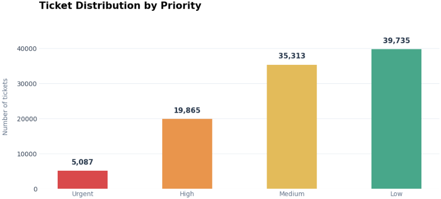
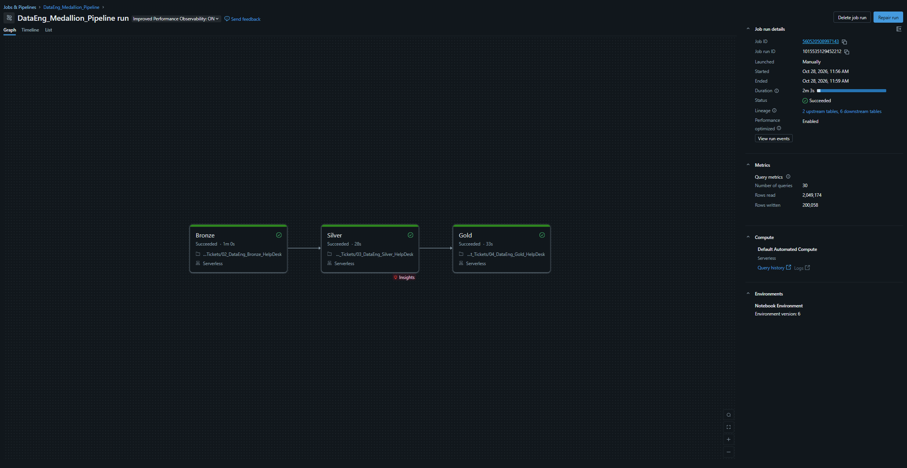

# IT Help Desk — Data Engineering Pipeline

**Databricks · PySpark · Python · SQL · Delta Lake · Unity Catalog · Lakeflow Jobs**

## Project Overview

This project focuses on building a Data Engineering pipeline using Databricks and PySpark, following the **Medallion Architecture (Bronze, Silver and Gold)**.

I worked with a dataset of **100,000 synthetic IT support tickets**, covering different priorities, issue types, support channels, regions and resolution statuses.

The goal was to take the original CSV dataset, explore its structure, apply data quality checks and transformations, and prepare aggregated tables that could later be used for reporting and analysis.

The project also includes a Databricks Lakeflow Job to execute the processing layers in the correct order.

## Dataset

**Source:** [Synthetic IT Support Tickets — Kaggle](https://www.kaggle.com/datasets/ahsanneural/synthetic-it-support-tickets)

The dataset contains information such as:

- Ticket creation dates and support channels
- Issue types, priorities and ticket statuses
- Customer segments and geographic regions
- Resolution times and customer satisfaction scores

The data is synthetic and was used for learning and portfolio purposes.

## Technologies Used

| Technology | Usage |
|------------|-------|
| Python | Exploratory data analysis and data quality checks |
| PySpark | Data processing and transformations |
| Databricks | Development and execution of the pipeline |
| Delta Lake | Storage of Bronze, Silver and Gold tables |
| Unity Catalog | Organization of data assets, tables and volumes |
| SQL | Data exploration and validation |
| Lakeflow Jobs | Orchestration of the processing notebooks |

## Pipeline Architecture

The pipeline follows the Medallion Architecture, separating raw data ingestion, data cleaning and reporting transformations into different layers.


**Data flow:**

`CSV Dataset → Bronze → Silver → Gold → Reporting-ready Tables`

The original CSV file is stored in a Unity Catalog Volume, while the processed datasets are saved as Delta tables.

## Data Processing

### 1. Exploratory Data Analysis (EDA)

Before creating the pipeline, I explored the dataset to understand its structure and identify possible data quality issues.

The analysis included:

- Checking the dataset schema and column types
- Identifying missing values
- Checking for duplicate ticket IDs
- Reviewing ticket priorities, issue types and statuses
- Analyzing monthly ticket volumes
- Understanding how resolution times and customer satisfaction scores are recorded

I also created a few visualizations to better understand the distribution of tickets.

#### Tickets by Priority



#### Monthly Ticket Volume


#### Tickets by Issue Type


### 2. Bronze Layer - Data Ingestion

The Bronze layer stores the original dataset before applying cleaning transformations.

I used PySpark to read the CSV file from a Unity Catalog Volume, automatically infer the column types and save the data as a Delta table.

I also added an ingestion timestamp to record when the data was loaded.

### 3. Silver Layer - Data Cleaning and Validation

The Silver layer prepares the data for analysis by applying cleaning rules and creating additional columns.

The main transformations included:

- Removing duplicate ticket IDs
- Converting date columns to the correct data types
- Standardizing priority, status and issue type values
- Mapping region codes to readable region names
- Creating a column to identify resolved tickets
- Preparing customer satisfaction scores for analysis

One important detail was handling the `NA` region code, which represents North America and should not be treated as a missing value.

I also excluded CSAT scores of `0` from satisfaction calculations, since these represent tickets without a survey response.

### 4. Gold Layer - Data Aggregation

The Gold layer uses the cleaned Silver data to create aggregated tables for reporting.

I prepared datasets covering:

- **Overall KPIs:** Ticket volumes, resolution performance and customer satisfaction
- **Monthly Trends:** Ticket activity over time
- **Priority Performance:** Ticket distribution and performance by priority
- **Regional Performance:** Comparison of support activity across regions

These tables provide a structured foundation for future dashboards and reporting without requiring additional cleaning.

## Pipeline Orchestration

After creating the processing notebooks, I configured a **Databricks Lakeflow Job** to execute the pipeline automatically in the correct sequence.

The workflow contains three dependent tasks:

`Bronze → Silver → Gold`

Each task starts only after the previous one has completed successfully.

The screenshot below shows a successful execution of the complete pipeline.



## Project Structure

```text
IT-HelpDesk-DataEngineering/
|
|-- README.md
|
|-- notebooks/
|   |-- 01_EDA.ipynb
|   |-- 02_Bronze.ipynb
|   |-- 03_Silver.ipynb
|   |-- 04_Gold.ipynb
|
|-- images/
    |-- Medallion_Architecture
    |-- Ticket_Dist_By_Priority.png
    |-- Monthly Ticket Volume.png
    |-- Tickets By Issue Type.png
    |-- databricks_job.png
```

## What I Learned

This project helped me put several Data Engineering concepts into practice, particularly working with PySpark DataFrames, Delta tables and Unity Catalog.

It also helped me understand why separating raw, cleaned and aggregated data into different layers makes a pipeline easier to organize and maintain.

The final step was connecting the notebooks through Lakeflow Jobs, allowing the Bronze, Silver and Gold layers to run as a single workflow.

## Possible Improvements

Some improvements I would like to explore in the future include:

- Incremental data ingestion instead of full reloads
- Additional automated data quality checks
- Expanding the Gold layer with additional reporting metrics
