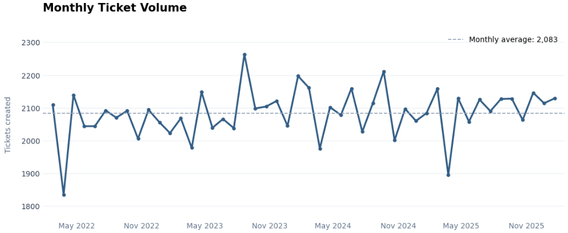

# IT Help Desk — Data Engineering Pipeline

**Databricks · PySpark · Python · SQL · Delta Lake · Unity Catalog · Lakeflow Jobs**

## Dataset

[Synthetic IT Support Tickets — Kaggle](https://www.kaggle.com/datasets/ahsanneural/synthetic-it-support-tickets)

## Project Overview

I built this project to practise Data Engineering using a dataset of 100,000 synthetic IT support tickets.

The project follows the **Medallion Architecture**, with three layers:

- **Bronze:** Raw data ingestion
- **Silver:** Data cleaning and validation
- **Gold:** Aggregated tables for reporting

## Pipeline Architecture

## Data Processing

### 1. Exploratory Data Analysis

Before creating the pipeline, I explored the dataset to better understand the tickets, their categories and how they changed over time.

### Tickets by Priority

### Monthly Ticket Volume

### Tickets by Issue Type

### 2. Bronze Layer

I loaded the CSV file into Databricks and saved it as a Delta table.

### 3. Silver Layer

I cleaned the data, standardized categories and added columns for reporting.

### 4. Gold Layer

I created reporting tables for ticket KPIs, monthly trends, priority performance and regional performance.

## Pipeline Orchestration

I used Databricks Lakeflow Jobs to run the Bronze, Silver and Gold notebooks in order. Each task runs after the previous one finishes successfully.

